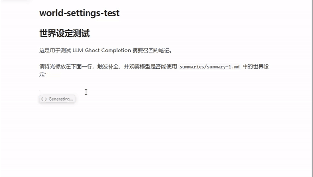

# Ghostwriter LLM for Obsidian

GitHub Copilot-style inline writing completion for Obsidian, powered by an OpenAI-compatible chat-completions API.

## Features

- Inline ghost-text completion at the cursor.
- Streaming responses with optional thinking preview.
- Preview mode for reviewing a completion before insertion.
- Named **writing modes** (presets): Note, Novel and Outline ship built in, each owning its own prompts, context strategy, recall, CoT and summary settings.
- Three context strategies per mode: `window` (fixed prefix/suffix window), `full` (the whole preceding text), and `in-note` (detect `[Summary]` / `[摘要]` blocks and send the summaries immediately before the unsummarized text).
- Configurable prompt templates, message roles, and completion context.
- OpenAI-compatible providers, including local servers such as llama.cpp.
- Manually generated note summaries stored as `summary-{number}.md` files, plus in-note paragraph summaries (`Generate In-Note Summary`).
- Prompt cache hit-rate reporting for providers such as DeepSeek.
- Configurable accept and dismiss shortcuts.

## Quick Start

1. Build the plugin with `npm install` followed by `npm run build`.
2. The build publishes `main.js`, `styles.css`, and `manifest.json` to the configured local test vault.
3. In Obsidian, open the plugin settings and configure the API base URL, API key, and model.
4. Run the command `Trigger LLM completion at cursor`.
5. Accept the suggestion with `Shift+Insert` or dismiss it with `Escape`.

The default publish directory is:

```text
test/test/.obsidian/plugins/ghostwriter-llm/
```

To publish to another local directory, set `OBSIDIAN_PLUGIN_DEST` before running `npm run publish`.

## Summaries

Summaries are never written into the source note. The `Generate summary for current note` command creates or updates a separate file in the configured summary folder, which defaults to `summaries/`.

Each generated file uses this format:

```markdown
---
source: "path/to/note.md"
---

The manually generated summary text.
```

Summary generation is manual. Summary injection can be enabled or disabled per writing mode in settings (`Summary recall`), or temporarily with the `Summary: ON/OFF` status-bar item or the `Toggle summary injection (session)` command. The `Note summary: ON/OFF` status-bar item and `Toggle current note summary injection` command persistently exclude or include the active note's summary without affecting other summaries.

### In-note summaries

For long fiction, `Generate In-Note Summary` (default `Mod+Shift+S`) summarizes the selected paragraph(s) and inserts the result right after them as a `> [Summary] …` block. When a mode uses the `in-note` context strategy, every such block before the cursor is collected and the summarized text is **not** sent raw — the summaries are injected immediately before the unsummarized tail, so the model sees the plot so far without the full prose. The marker is recognized anywhere in a line (`> [Summary] …`, `text > [Summary] …`, `[摘要] …`, `【摘要】…`). With no markers present, `in-note` falls back to sending the full preceding text.

The bottom status bar shows `Cache: ...` after each completion, and preview mode shows the full prompt-cache usage. DeepSeek automatically caches matching prompt prefixes server-side and reports `prompt_cache_hit_tokens` and `prompt_cache_miss_tokens`; the plugin calculates the hit rate from those response fields. Providers that do not report these fields show `N/A`.

## Writing Modes

A **writing mode** is a named preset. It owns the system prompt, prompt template, extra prompt, message roles, chain-of-thought settings, word/temperature limits, cursor context size, recall settings, context strategy and summary settings. Three modes ship built in, in Chinese or English (choose the language with **Default prompt language**):

| Mode | Context strategy | Intended use |
| --- | --- | --- |
| Note mode | `window` | General note completion with a fixed prefix/suffix window. |
| Novel mode | `in-note` | Fiction continuation; replaces summarized paragraphs with their `[Summary]` blocks. |
| Outline mode | `full` | Outlines and structural design over the whole preceding text. |

Use the **Active mode** dropdown, the `Switch writing mode` command, or a per-vault shortcut to switch. Modes can be renamed, duplicated, added, deleted, and restored to their built-in defaults (in either language). Providers, the summary folder/scan limit, per-file summary switches and UI options stay global.

## Commands

- `Trigger LLM completion at cursor`
- `Trigger LLM completion with an instruction` (default `Mod+Shift+Enter`)
- `Switch writing mode`
- `Generate In-Note Summary` (default `Mod+Shift+S`)
- `Generate summary for current note`
- `Show summary status`
- `Toggle summary injection (session)`
- `Toggle current note summary injection`
- `Dismiss current LLM suggestion`

## Settings Groups

- **Providers**: multiple OpenAI-compatible profiles (Base URL, API key, model) with model-list fetching; the active profile is the single source of truth for the connection.
- **Writing modes**: active mode, rename/add/duplicate/delete, default prompt language, and restore-to-defaults.
- **Generation limits** (per mode): word limit and temperature. The request timeout and the hard token cap live in Advanced.
- **Prompt & context** (per mode): system prompt, prompt template, extra prompt, and cursor context size.
- **Recall level** (per mode): how much context is collected (cursor window, summaries, linked notes).
- **Summary recall**: the injection toggle, generation model/max words/max tokens/temperature/input chars, and in-note summary prompt are per mode; the summary folder, scan limit, per-file switches and status panel are global.
- **Reasoning** (per mode): optional chain-of-thought toggle and template. The CoT trigger and message roles remain in data (and in exported prompt bundles) but are no longer shown in the UI.
- **Context strategy** (per mode): `window`, `full` or `in-note` (see Writing Modes above), plus the in-note summary generation prompt.
- **Display & shortcuts**: preview mode, streaming, thinking preview, and keyboard shortcuts.
- **Advanced** (collapsed): prompt restore/export/import, request timeout, max tokens, custom HTTP headers, adjacent total chars, manual fallback summary, and the remaining summary generation limits.

## Demo



## Development

```bash
npm install
npm run build
npm run dev
```

`npm run build` runs the TypeScript check, creates a production bundle, and publishes the plugin files to the local test vault. `npm run dev` starts the esbuild watch process.

## License

MIT
